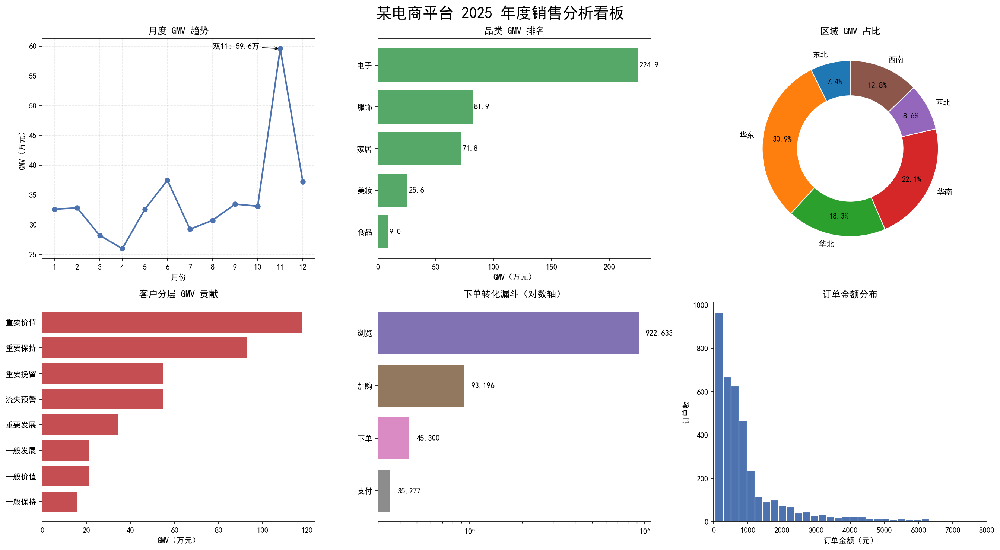
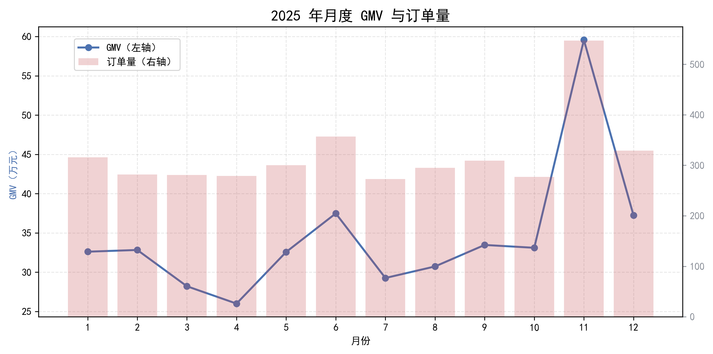
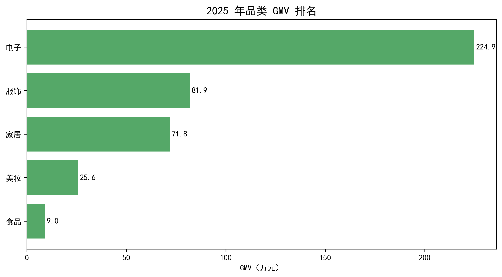
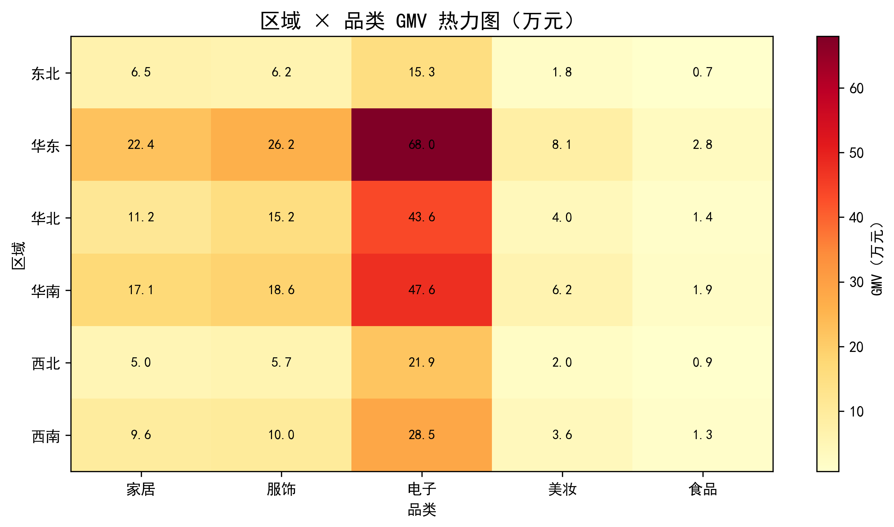
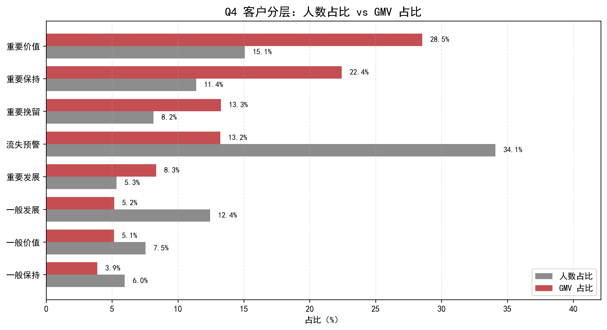
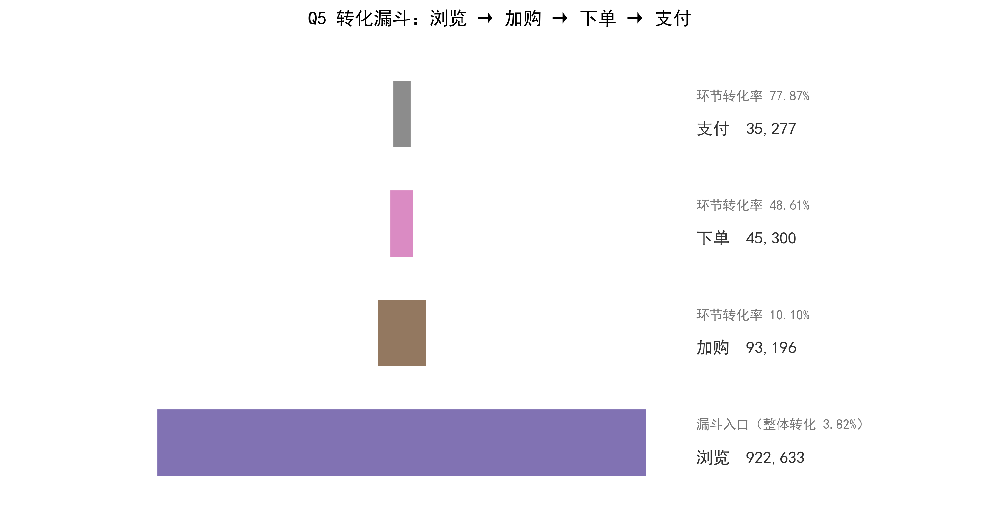
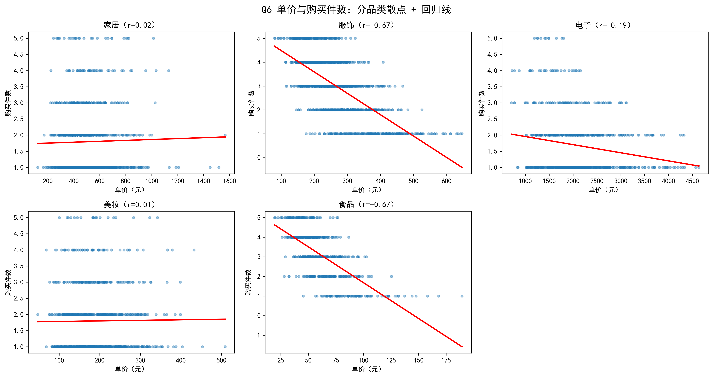

# 某电商平台 2025 年度销售数据分析报告

> **分析对象**：某电商平台 2025 年订单、用户与转化漏斗数据
> **业务方**：平台运营部
> **分析角色**：数据分析实习生
> **数据说明**：全部为 `np.random.seed(42)` 生成的模拟数据，用于方法演示；结论不代表真实平台
> **核心口径**：仅统计 `status='已完成'` 且 `is_outlier=False` 的订单（3,845 笔）

**一句话结论**：全年 GMV **413.15 万元**，下半年比上半年增长 **17.75%**，但增长高度依赖双 11 单月（59.57 万元）与电子品类（占 54.43%）；真正的问题在东北区域与客户留存。

---

## 摘要

**三条核心结论**

1. **节奏：全年"两头高、中间平、11 月尖峰"**。11 月 GMV 59.57 万元，环比 +79.90%，是全年峰值；4 月 26.01 万元为谷值；下半年 223.41 万元，比上半年 189.74 万元增长 17.75%。
2. **结构：品类集中度过高**。电子 GMV 224.86 万元、占比 54.43%、下半年增速 +25.71%，是唯一"高占比 + 高增速"的引擎；食品 9.01 万元、占比 2.18%、增速 -1.29%，是唯一下滑品类。
3. **客户：两极分化**。15.07% 的重要价值客户贡献 28.55% GMV；与此同时 34.09%（389 人）的用户处于流失预警，只贡献 13.22% GMV。

**三条建议（按优先级）**

- **P0**：把 Q4 大促预算前置到 10 月下旬，目标 11 月 GMV 环比不低于 +60%。
- **P1**：对"重要保持 + 重要挽留"共 223 名高价值流失客户做定向召回，目标 30 天召回率 ≥ 15%。
- **P2**：浏览→加购转化从 10.10% 提升到 11.10%，预计全年增加约 3,500 笔支付。



*图 1　2025 年度销售分析看板（月度 / 品类 / 区域 / 客户 / 漏斗 / 金额分布）*

---

## 一、数据与方法

### 1.1 数据来源与样本

| 数据表 | 规模 | 说明 |
|--------|------|------|
| `orders.csv`（原始） | 5,050 行 × 11 列 | 2025-01-01 ~ 2025-12-31 全量订单，含 7 类人为植入的质量问题 |
| `clean_orders.csv`（清洗后） | 4,800 行 × 12 列 | 去重、类型转换、规则过滤、格式统一、离群标记后 |
| `users.csv` | 1,200 行 × 5 列 | 用户注册信息，`age` 缺失 8% |
| `funnel.csv` | 30 行 × 5 列 | 2025-11-01 ~ 11-30 的浏览、加购、下单、支付人数 |

**分析样本**：清洗后 4,800 笔订单中，状态为"已完成"的有 3,887 笔，剔除 42 笔离群订单后得到 **3,845 笔**有效成交订单，覆盖 **1,141 位**购买用户。

> 说明：全表共标记 47 笔离群订单，其中 42 笔落在"已完成"订单内，故分析样本剔除 42 笔。

### 1.2 指标字典

| 指标 | 业务定义 | 计算公式 | 数据来源 | 口径决策 |
|------|----------|----------|----------|----------|
| GMV | 成交总额 | `Σ amount`，仅 `status='已完成'` | orders | 不含已取消、不含退款 |
| 订单数 | 成交订单笔数 | `count(order_id)` | orders | 按订单号去重后计数 |
| 客单价 | 平均每单金额 | `GMV / 订单数` | orders | 分母是订单数，不是人数 |
| 复购率 | 重复购买用户占比 | 购买 ≥2 次人数 / 总购买人数 | orders | 按用户维度，不是订单维度 |
| 品类占比 | 该品类 GMV 份额 | 品类 GMV / 总 GMV | orders | 分母含全部品类 |
| 环比 | 与上月相比的增长率 | `(本月 - 上月) / 上月` | orders | 首月无环比，记 NaN |
| 环节转化率 | 下一步人数占比 | 下一环节 / 上一环节 | funnel | 逐级计算，不是相对首环节 |
| 整体转化率 | 支付人数占比 | `pay_cnt / view_cnt` | funnel | 用于对外汇报的口径 |

**三个口径分歧的当场决策**

| 歧义 | 可选做法 | 本项目决策 | 理由 |
|------|----------|-----------|------|
| 退款订单算不算 GMV | 算 / 不算 | **不算** | 退款没有真实收入 |
| 金额缺失的订单怎么办 | 删除 / 用单价×数量补 | **删除** | 补齐等于编造数据，且缺失率仅 3% |
| 去重依据是什么 | 整行去重 / order_id 去重 | **order_id 去重** | 一单一行，order_id 是业务主键 |

### 1.3 数据质量与清洗

**体检发现的问题（8 项检查全部命中）**

| 问题类型 | 涉及字段 | 实测行数 | 处理方式 | 决策理由 |
|----------|----------|----------|----------|----------|
| 完全重复 | 整行 / order_id | 50 | 按 order_id 去重 | 一单一行，业务主键唯一 |
| 非法日期 | order_date | 20 | `to_datetime(errors='coerce')` 后剔除 | 无法推断真实下单日 |
| 金额缺失 | amount | 153（3.03%） | 剔除 | 补齐等于编造 |
| 区域缺失 | region | 94（1.86%） | 填"未知" | 区域可能确实未填写，保留订单 |
| 区域格式 | region | 202 | `strip` + 去"区" | 统一为 6 大区 |
| 单价异常 | unit_price | 15（8 条为 0、7 条为负） | 剔除 | 0 或负价无业务意义 |
| 数量异常 | quantity | 10 | 剔除 | 数量 0 却有金额，逻辑不成立 |
| 金额不一致 | amount | 9 | 剔除 | 与"单价×数量"偏差 > 1% |
| 离群金额 | amount | 47 | 标记 `is_outlier`，分析时排除 | 疑似录入错误，但保留痕迹可追溯 |

**清洗链路（逐项可追溯，日志见 `output/clean_log.txt`）**

```
5050 → 5000（按 order_id 去重 -50）
     → 4980（非法日期剔除 -20）
     → 4832（金额缺失剔除 -148）
     → 4818（单价<=0 剔除 -14）
     → 4808（数量<=0 剔除 -10）
     → 4800（金额与单价×数量偏差>1% 剔除 -8）
     离群标记 47（不删除）
```

| 指标 | 清洗前 | 清洗后 | 变化 |
|------|--------|--------|------|
| 行数 | 5,050 | 4,800 | -250（-4.95%） |
| 列数 | 11 | 12 | +1（`is_outlier`） |
| amount 缺失 | 153 行 | 0 | 已剔除 |
| region 写法 | 11 种 | 6 种（无"未知"） | 已统一 |
| order_date 类型 | 字符串 | datetime64 | 已转换 |
| 重复订单 | 50 | 0 | 已去重 |

> 清洗顺序为"去重 → 类型 → 业务规则 → 缺失 → 格式 → 离群标记"。顺序错了会导致缺失率、异常数全部对不上账。

### 1.4 分析口径与敏感性说明

| 口径 | 订单数 | GMV | 客单价 |
|------|--------|-----|--------|
| 已完成订单（含离群） | 3,887 | 464.09 万元 | 1,193.96 元 |
| **已完成订单（剔除离群，本报告采用）** | **3,845** | **413.15 万元** | **1,074.52 元** |

两个口径相差 **51 万元（11%）**，差异来自 42 笔异常大额订单。本报告采用剔除离群口径，理由是其金额已被放大 200 倍、不能代表真实成交能力；对外与财务核对时，应使用含税含退款的财务口径。

---

## 二、核心发现

### Q1　全年卖得怎么样？有没有淡旺季？



*图 2　2025 年月度 GMV（折线，左轴）与订单量（柱，右轴）*

| 月份 | GMV（万元） | 订单量 | 环比 |
|------|------------|--------|------|
| 1 月 | 32.62 | 316 | — |
| 2 月 | 32.83 | 282 | +0.67% |
| 3 月 | 28.22 | 281 | -14.06% |
| 4 月 | 26.01 | 279 | -7.83% |
| 5 月 | 32.58 | 300 | +25.27% |
| 6 月 | 37.49 | 357 | +15.06% |
| 7 月 | 29.27 | 273 | -21.92% |
| 8 月 | 30.74 | 295 | +5.02% |
| 9 月 | 33.47 | 309 | +8.90% |
| 10 月 | 33.11 | 277 | -1.08% |
| **11 月** | **59.57** | **547** | **+79.90%** |
| 12 月 | 37.25 | 329 | -37.47% |

**结论**：11 月 GMV 59.57 万元（环比 +79.90%）为全年峰值，与双 11 大促吻合；4 月 26.01 万元为谷值。下半年 223.41 万元比上半年 189.74 万元增长 **17.75%**。
**洞察**：全年增长几乎由单月大促拉动——剔除 11 月后，其余 11 个月月均 GMV 仅 32.14 万元，且除 11、12 月（受大促基数影响）外，月度环比波动仅在 -21.92% ~ +25.27% 之间，属于"无大促即平销"的健康度偏低结构。
**建议**：Q4 预算前置到 10 月下旬；4 月淡季用"春季上新 + 会员日"拉动，目标把谷值提到 30 万元以上。

### Q2　哪些品类在增长，哪些在拖后腿？



*图 3　2025 年品类 GMV 排名（万元）*

| 品类 | GMV（万元） | 订单量 | 客单价（元） | GMV 占比 | 下半年增速 |
|------|------------|--------|--------------|----------|-----------|
| 电子 | 224.86 | 662 | 3,396.70 | 54.43% | +25.71% |
| 服饰 | 81.90 | 1,134 | 722.25 | 19.82% | +11.38% |
| 家居 | 71.78 | 778 | 922.61 | 17.37% | +7.29% |
| 美妆 | 25.59 | 745 | 343.53 | 6.19% | +9.67% |
| 食品 | 9.01 | 526 | 171.38 | 2.18% | -1.29% |

**结论**：电子是唯一"高占比 + 高增速"的引擎（54.43%、+25.71%）；食品是唯一下滑品类（-1.29%）。
**洞察**：单品类占 GMV 超过一半，一旦电子出现供应链或价格战问题，整体 GMV 将直接受冲击——这是**品类集中度风险**，不是"电子做得好"这么简单。
**建议**：电子继续加投，但同步做"电子 + 家居"组合提升连带率；食品做小包装尝鲜款测试，若连续两个季度仍负增长则收缩 SKU。

> 口径说明：数据仅有 2025 年，无法做真正"同比"，故用"下半年 vs 上半年"衡量动能，属口径替代而非同比。

### Q3　各区域表现差在哪？问题区域是谁？



*图 4　区域 × 品类 GMV 热力图（万元）*

| 区域 | GMV（万元） | 订单量 | 客单价（元） | GMV 占比 | 复购率 |
|------|------------|--------|--------------|----------|--------|
| 华东 | 127.53 | 1,215 | 1,049.66 | 30.87% | 42.37% |
| 华南 | 91.36 | 857 | 1,066.00 | 22.11% | 33.50% |
| 华北 | 75.43 | 680 | 1,109.32 | 18.26% | 23.53% |
| 西南 | 53.00 | 513 | 1,033.21 | 12.83% | 21.84% |
| 西北 | 35.44 | 287 | 1,234.88 | 8.58% | 14.98% |
| **东北** | **30.38** | **293** | **1,036.97** | **7.35%** | **11.15%** |

**结论**：华东规模与质量双优（30.87% GMV、42.37% 复购率）；东北是"规模小 + 客单低 + 留存差"的三重短板区域（7.35%、1,036.97 元、11.15%，三项均为全国最低或接近最低）。
**洞察**：东北客单价已全国最低，再降价只会压缩利润——数据指向的是**体验问题（物流时效、退换货）**，不是价格问题。西北客单价 1,234.88 元全国最高但订单量仅 287 笔，属"高客单、低渗透"。
**建议**：华东保持投入；东北启动"服务体验专项"；西北做"新客首单补贴"扩大渗透，而非全区域降价。

### Q4　客户结构健康吗？大客户跑了多少？



*图 5　客户分层：人数占比 vs GMV 占比（观察日 2026-01-01）*

| 客户类型 | 人数 | 人数占比 | GMV 占比 | 人均消费（元） |
|----------|------|----------|----------|----------------|
| 重要价值客户 | 172 | 15.07% | 28.55% | 6,857.01 |
| 重要保持客户 | 130 | 11.39% | 22.43% | 7,128.30 |
| 重要挽留客户 | 93 | 8.15% | 13.26% | 5,892.61 |
| 流失预警客户 | 389 | 34.09% | 13.22% | 1,404.22 |
| 重要发展客户 | 61 | 5.35% | 8.35% | 5,652.59 |
| 一般发展客户 | 142 | 12.45% | 5.17% | 1,503.52 |
| 一般价值客户 | 86 | 7.54% | 5.15% | 2,472.97 |
| 一般保持客户 | 68 | 5.96% | 3.88% | 2,355.77 |

**结论**：核心客户（重要价值 + 重要保持 + 重要挽留 + 重要发展）共 456 人、占 39.96%，贡献 **72.59%** 的 GMV；流失预警客户 389 人（34.09%）仅贡献 13.22%。
**洞察**：符合典型二八结构，但"重要保持"客户人均消费 7,128.30 元为全群最高、却已超过半年未回购——这是**最值得花钱召回的一群人**，不是流失预警里的低价值用户。
**建议**：① 重要价值客户做专属客服 + 新品优先购；② 重要保持 / 重要挽留共 223 人做定向召回（30 天召回率 ≥ 15%）；③ 流失预警客户只做"低门槛券 + 品类推荐"筛选回捞，不做全额补贴。

> 说明：RFM 用五分位（qcut）打分，阈值与结果依赖观察日（2026-01-01），报告中已注明。

### Q5　从进店到付款，到底卡在哪一步？



*图 6　2025 年 11 月转化漏斗（浏览 → 加购 → 下单 → 支付）*

| 环节 | 人数 | 环节转化率 |
|------|------|-----------|
| 浏览 | 922,633 | — |
| 加购 | 93,196 | 10.10% |
| 下单 | 45,300 | 48.61% |
| 支付 | 35,277 | 77.87% |

**结论**：整体转化率 **3.82%**；浏览→加购仅 **10.10%**，是全链路最大瓶颈；下单→支付 77.87%，处于行业健康区间（70%~85%）。
**洞察**：问题不在支付环节，而在"看的人不加入购物车"——详情页的说服力与加购引导才是短板。
**建议**：优先优化商品详情页（主图、卖点、评价、价格锚点）与加购引导（凑单、限时优惠）；浏览→加购每提升 1 个百分点，全年支付人数约增加 **3,500 人**（922,633 × 1% × 48.61% × 77.87% ≈ 3,494）。

> 局限：漏斗为 11 月单月数据，不能直接外推全年；收益测算以 11 月结构为假设。

### Q6　降价到底能不能换来销量？



*图 7　分品类单价与购买件数散点 + 回归线*

| 范围 | 相关系数 r | 样本量 | 判断 |
|------|-----------|--------|------|
| 整体 | -0.281 | 3,845 | 弱负相关 |
| 服饰 | **-0.665** | 1,134 | 强负相关，价格敏感 |
| 食品 | **-0.666** | 526 | 强负相关，价格敏感 |
| 电子 | -0.189 | 662 | 弱负相关 |
| 家居 | +0.024 | 778 | 几乎无关 |
| 美妆 | +0.011 | 745 | 几乎无关 |

**结论**：价格与销量存在明显品类差异——服饰、食品强负相关（r ≈ -0.67），属价格敏感型；家居、美妆接近 0，属价格不敏感型。
**洞察**：降价换量只对敏感品类有效；对家居、美妆降价，等于直接损失利润而换不来销量。
**建议**：服饰、食品用满减、第二件半价、组合装拉动销量；电子、家居、美妆把预算转向增值服务（延保、以旧换新、赠品）与内容种草。

> ⚠️ 相关不等于因果：r = -0.665 只说明"单价高时件数少"，不能证明"降价一定带来同比例增长"。要验证因果，需做同款商品随机分组的 A/B 测试。

### 六大结论速览

| 问题 | 一句话结论（带数据） | 建议动作 |
|------|---------------------|----------|
| Q1 走势 | 11 月 59.57 万元（+79.90%）为峰值，4 月 26.01 万元为谷值；下半年 +17.75% | Q4 集中投放；4 月会员日补淡季 |
| Q2 品类 | 电子占 54.43%、增速 +25.71%，是第一引擎；食品 -1.29% 唯一下滑 | 电子加投但做连带；食品收缩 SKU |
| Q3 区域 | 华东占 30.87%、复购 42.37%；东北 7.35%、复购 11.15%，三重短板 | 东北修体验；西北做拉新 |
| Q4 客户 | 重要价值 15.07% 贡献 28.55% GMV；流失预警 389 人仅贡献 13.22% | 重点召回"重要保持/挽留"；预警客户低门槛召回 |
| Q5 漏斗 | 浏览→加购仅 10.10%，是最大瓶颈；整体 3.82% | 优化详情页与加购引导，+1 点 ≈ +3,500 笔支付 |
| Q6 价格 | 服饰 r=-0.665、食品 r=-0.666；家居/美妆 ≈ 0 | 敏感品类做促销，不敏感品类做增值 |

---

## 三、行动建议

| 优先级 | 动作 | 现状 | 目标值 | 责任方 | 衡量指标 |
|--------|------|------|--------|--------|----------|
| **P0** | Q4 大促预算前置至 10 月下旬 | 11 月环比 +79.90%，但增长过度集中在单月 | 11 月 GMV 环比 ≥ +60% | 运营部 + 市场部 | 11 月 GMV、投放 ROI |
| **P1** | 223 名高价值流失客户定向召回 | 重要保持 130 人（人均 7,128 元）+ 重要挽留 93 人 | 30 天召回率 ≥ 15% | 用户运营 | 召回率、复购 GMV |
| **P2** | 浏览→加购转化提升 1 个百分点 | 10.10%（92.26 万浏览 → 9.32 万加购） | 11.10%，全年 +3,500 笔支付 | 产品 + 内容 | 详情页加购率、A/B 结果 |

补充（P2 之后）：东北区域"服务体验专项"（物流时效、退换货流程），目标 90 天内复购率从 11.15% 提升至 15%；食品品类做小包装尝鲜款测试，两个季度仍负增长则收缩 SKU。

---

## 四、风险与局限

1. **数据性质**：全部为模拟数据，结论用于方法演示，不能直接用于真实经营决策。
2. **时间跨度**：仅 2025 年一年，无法做同比；"下半年 vs 上半年"只能衡量动能。
3. **口径差异**：本报告 GMV 413.15 万元与含离群口径 464.09 万元相差 11%，与财务口径（含税含退款）差异更大，对外汇报须注明。
4. **因果边界**：Q6 为相关性证据，降价与销量的因果关系需 A/B 测试验证。
5. **漏斗外推**：漏斗仅覆盖 11 月，大促期结构不能代表全年。
6. **RFM 依赖观察日**：观察日推后，全体 R 值增大、分层结果会变化，报告中已注明观察日。

---

## 附录

### A. 复现方式

```powershell
cd D:\实训\大作业\production-project
python src\gen_data.py
python src\01_quality_check.py
python src\02_clean.py
python src\03_feature.py
python src\04_analysis.py
python src\05_visualize.py
```

所有脚本用 `__file__` 定位项目根目录，在任意工作目录下都能运行；`gen_data.py` 固定 `np.random.seed(42)`，结果可完全复现。

### B. 产物清单

| 路径 | 内容 |
|------|------|
| `data/raw/` | `orders.csv`、`users.csv`、`funnel.csv` |
| `data/processed/` | `clean_orders.csv`、`orders_feature.csv`、`user_feature.csv` |
| `output/clean_log.txt` | 七步清洗日志 |
| `output/quality_report.md` | 8 项体检结果 + 数据问题清单 |
| `output/analysis_summary.txt` | Q1~Q6 分析结果与结论速览 |
| `output/dashboard.png` | 2×3 综合看板 |
| `output/q1_gmv_trend.png` 等 6 张 | Q1~Q6 专题图 |

### C. 清洗日志（`output/clean_log.txt` 摘录）

```
原始数据: 5050 行 × 11 列
① 按 order_id 去重: 5050 → 5000（删除 50 行）
② 非法日期转 NaT 并剔除: 5000 → 4980（删除 20 行）
③ 金额缺失剔除: 4980 → 4832（删除 148 行）
④ 单价<=0 剔除: 4832 → 4818（删除 14 行）
⑤ 数量<=0 剔除: 4818 → 4808（删除 10 行）
⑥ 金额与单价×数量偏差>1% 剔除: 4808 → 4800（删除 8 行）
⑦ IQR 标记离群金额: 47 行（不删除）
最终规模: 4800 行 × 12 列
```
